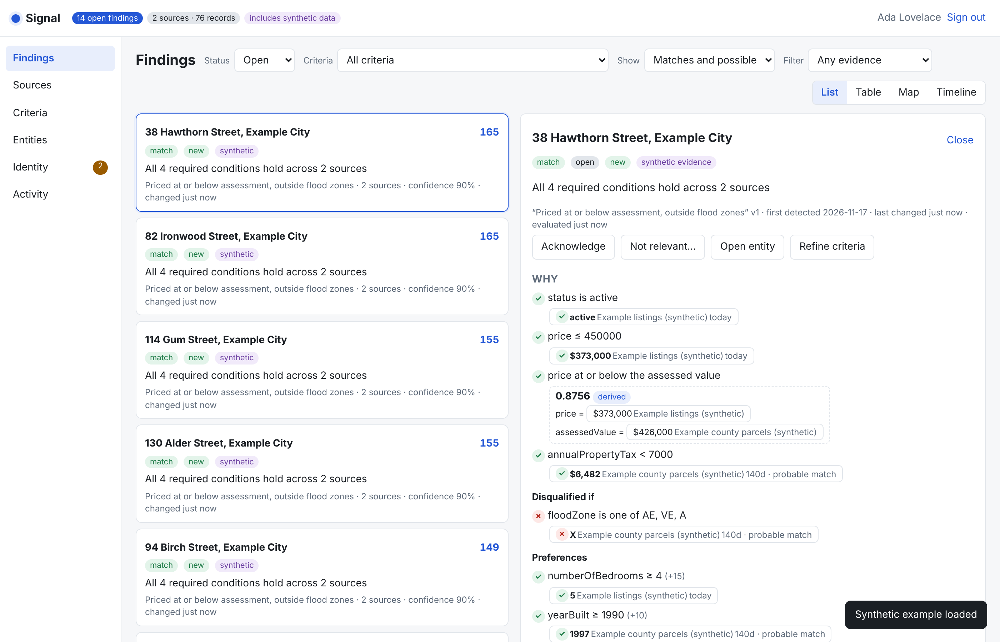

# Signal

**Given everything I can see, everything I have connected, and everything I care about — what is important right now?** Signal keeps answering that question as the information changes.

You connect sources. Signal keeps each source's records separate and versioned, works out which records describe the same thing (and says how sure it is), and continuously evaluates them against criteria you define. What qualifies becomes a **finding** with a priority, a confidence, an explanation down to each source value, and a history of how it appeared, changed and resolved.

No language model runs anywhere in this path. Evaluation is deterministic: the same evidence and criteria give the same result.



## The model

```
Source ──refresh──▶ Ingestion ──(only if content changed)──▶ Observation vN   (v1…vN-1 kept, retractions kept)
                                                               │
                                     identity resolution ──▶ Link  exact · probable · ambiguous · conflict · unmatched · manual
                                                               │
                                                             Entity  (what several sources describe)
                                                               │
             Criteria vK (yours, immutable versions) ──▶ Evaluation  true · false · unknown(missing | stale | conflict | …)
                                                               │
                                                             Finding  new · changed · persistent · resolved · superseded · invalid · reopened
                                                               └── history (each event names its cause), evaluation runs, notification
```

Separate events, never conflated: a **refresh** (an ingestion) is not **new information** (a new observation version); new information is not a **meaningful change** (a finding event, governed by your change thresholds); a meaningful change is not a **qualifying finding**; and a finding is not an **action** (acknowledging or dismissing is yours; detection never acts).

| Concept | What it is | Where |
|---|---|---|
| **Source** | Something Signal can see, with kind, origin (native/user), status, refresh mode, freshness rule, mapping (versioned) | `feltkit/sources.ts` |
| **Observation** | One source record's statement at a version: original value, normalized value, unit, transform; observed-at, as-of, last-confirmed | `lib/engine/mapping.ts`, `feltkit/_store.ts` |
| **Identity** | Tiered and evidence-based: shared identifier → address (+coordinates) → containment → coordinates. Ambiguous and conflicting records are never merged; a person decides | `lib/engine/identity.ts` |
| **Criteria** | `signal.criteria/v2`: required, disqualifying and preferred conditions; all/any groups; derived values across sources; freshness; source restriction and trust; change thresholds; notifications | `lib/engine/criteria.ts` |
| **Evaluation** | One three-valued evaluator. Missing ≠ negative; stale evidence does not count; disagreeing sources make a condition unknown unless trust decides | `lib/engine/evaluate.ts` |
| **Finding** | Lifecycle, dedup by meaningful change, priority = score × confidence + recency, explained | `lib/engine/lifecycle.ts`, `feltkit/findings.ts` |

### Sources supported

| Kind | Origin | How it changes | Verified with |
|---|---|---|---|
| **File** — CSV, GeoJSON, JSON | user | Snapshot: each upload is compared with the last; missing records are withdrawn | tests, browser |
| **HTTP JSON API** | user | Fetched on request (`Refresh now`, `sources:refresh`), conditional GET, SSRF guard. *Not scheduled* (see limits) | tests (local HTTP server) |
| **Push** | user | A system calls the `signal.sources.push` capability; evaluated in the same transaction | tests |
| **Manual records** | native | Entered in Signal | — (same path as push) |
| **Browser capture** | native | Pages captured in your own browser with the extension; partial by nature (absence is not removal) | e2e with real Chromium + extension |

Credentialed APIs and databases are not supported yet; nothing pretends otherwise.

## Run

```bash
npm install
```

```bash
npm run dev
```

Open the printed URL, sign in as a development user, and either **Connect a source** or **Load a synthetic example** (two invented sources and one criteria, labelled synthetic everywhere).

```bash
npm test
```

```bash
npm run test:e2e
```

```bash
npm run measure
```

- `npm test` runs `feltkit test`: the pure engine, page extraction quality on 16 real pages, and the end-to-end product scenario against a real FeltDB instance and a real HTTP server.
- `npm run test:e2e` runs the browser tests: the extension end to end (a real `feltkit dev` server, real Chromium with the extension loaded) and the capture-reduction check on real pages. Stop `npm run dev` first (one dev server per project).
- `npm run measure` prints timings at several data sizes (synthetic data). Results are in `docs/measurements.json`.

### Browser extension

```bash
npm run build:extension
```

Load `extension/dist` unpacked in Chrome (`chrome://extensions` → Developer mode). In the side panel: connect to your instance, sign in, choose or create a **capture source** (which item types it keeps, e.g. `RealEstateListing`), and press **Capture this page**. The panel reports what was new or changed and which of your findings the page's items are part of. Signal never fetches these pages itself.

### For systems: push and read

Push records into a push source (AppPort capability `signal.sources.push`, or the FeltKit client):

```ts
await client.mutation(api.sources.push, { sourceId, records: JSON.stringify([{ listing_id: "A1", price: 289000 }]) });
// → { added, changed, unchanged, newInformation, run: { entities, created, changed, closed, reopened, durationMs } }
```

Read findings in priority order (capability `signal.findings.list`), each with why it was surfaced and whether its evidence is conflicting, stale or missing.

## Layout

```
feltkit/            the FeltKit application
  app.ts              collections, roles, ownership rule
  _store.ts           the one pipeline: ingest → change detection → identity → evaluation → findings
  sources.ts          connect, inspect, upload, push, capture, refresh (action), mapping versions, pause, remove, coverage
  criteria.ts         save (versioned), preview, attributes catalog, enable/remove
  findings.ts         prioritized list, full evidence trail, acknowledge/dismiss, timeline
  entities.ts         side-by-side evidence, identity decisions (assign / separate)
  engine.ts           freshness sweep (a schedulable mutation), activity, summary
  workspace.ts        the synthetic example
lib/
  engine/             pure, framework-free: types, mapping, identity, criteria, evaluate, lifecycle, coverage, policy
  sources/            records (CSV/GeoJSON/JSON), HTTP JSON (guarded), page capture → observations, network guard
  page/               page intelligence: signal.page/v1 extraction (retained, measured)
src/                the web app (vanilla TypeScript on the FeltKit client; live via the change stream)
extension/          the browser capture client
tests/              engine, page quality, the product scenario; e2e/ for browser tests
```

## Documents

| Document | What it answers |
|---|---|
| [ASSESSMENT.md](ASSESSMENT.md) | What existed, what was kept, replaced and removed, and why |
| [GAP_REGISTER.md](GAP_REGISTER.md) | What is missing or limited: product, platform, operational — with evidence |
| [FAIR_HOUSING_REVIEW.md](FAIR_HOUSING_REVIEW.md) | What the real-estate scenario uses, the guard that exists, and the policy questions still open |
| [PAGE_INTELLIGENCE.md](PAGE_INTELLIGENCE.md), [PAGE_QUALITY.md](PAGE_QUALITY.md) | The page extractor behind browser capture, measured on real pages |
| `docs/measurements.json` | Measured timings (synthetic data) |

## Known limits (details in GAP_REGISTER)

- **No scheduled outbound fetch.** FeltKit jobs run mutations and mutations may not fetch, so HTTP sources refresh on request, not on a timer. Push sources and captures are evaluated the moment they arrive. The freshness sweep is a mutation and can be scheduled.
- **Everything has been validated on synthetic data** (and 16 real pages for extraction). No real county parcel file or real listing feed has been run end to end.
- **One transaction per ingestion.** Measured up to 2,000 records per source; bulk imports and full re-evaluations take seconds to tens of seconds at that size (`docs/measurements.json`).
- **No credentials for sources, no database sources.**
- **No natural-language criteria drafting.** Criteria are written in the structured editor or as JSON.
- **Single tenant**, owner-scoped records.
