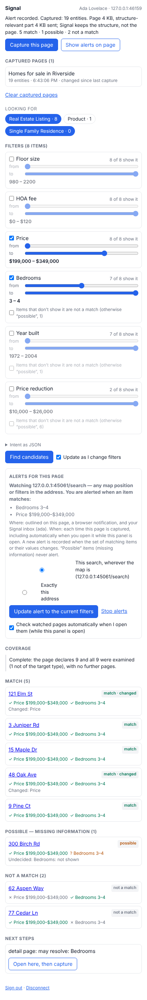

# Signal

**Observe. Interpret. Evaluate. Act.** Signal makes accessible information observable, interpretable, actionable and continuously relevant to the person or application that cares about it.

Give Signal an authorized source, a set of declarative criteria, and who should hear about it. Signal deterministically:
1. observes the source and preserves the exact bytes it saw;
2. interprets them: builds a site-agnostic representation of the page (entities, attributes, relationships, collections, each with evidence), extracts fields, and decodes embedded signals, including Ghostpost's invisible-Unicode payloads;
3. evaluates the criteria and records *why* with a full trace;
4. produces a durable, deduplicated event;
5. notifies people through AppPort Notifications and systems through AppPort Webhooks;
6. shows it in context with an in-page overlay.

No LLM runs anywhere in that path.

Signal is a **FeltKit application** (`npm create feltkit@latest signal`). FeltKit and the Boundry platform supply durable state (FeltDB), authorization, AppPort capabilities, evidence storage (Files) and delivery. Signal supplies the capability.

```
feltkit/          the application: collections, roles, ownership rule, functions
  app.ts            roles, authorize hook, signal_* collections
  sources.ts        sources:register|list
  criteria.ts       criteria:define|get          (immutable signal.criteria/v1 versions)
  monitors.ts       monitors:create|observe|push|record|history
  events.ts         events:list|forPage|evidence|acknowledge|inbox
  pages.ts          pages:inspect|push|get|list    (signal.page/v1, no criteria needed)
lib/              Signal's capability: pure, framework-free
  codecs/           ghostpost-unicode/v1 (WASM), invisible-unicode/v1
  interpret/        normalization (preserves invisible signals), extraction
  page/             universal page intelligence: signal.page/v1, extraction, typing, entity criteria
  core/             deterministic criteria evaluator, the pure cycle decision
  sources/          HTTP observation: robots.txt, conditional GET, SSRF guard
  overlay/          in-page overlay (host transport, closed shadow root)
  contracts/        record shapes (signal.*/v1)
codecs/ghostpost-unicode/   Rust codec extracted from rkendel1/ghostpost (wire-identical) + built WASM
examples/         documented use cases, each executed by the tests
tests/            feltkit test suite (library, application, use cases, browser overlay)
```

## Run

```bash
npm install
```

```bash
npm test
```

```bash
npm run test:codec
```

```bash
npm run bench
```

```bash
node scripts/bench-pages.ts
```

```bash
npm run dev
```

- `npm test` runs `feltkit test`: 91 tests against real FeltDB, AppPort services and headless Chromium.
- `npm run test:e2e` runs both browser tests: the extension end to end, and the snapshot reduction on the real pages.
- `npm run test:extension` builds the browser extension and runs it end to end. It uses a real `feltkit dev` server with isolated state and real Chromium with the extension loaded.
- `npm run test:codec` runs the Rust codec tests (12).
- `npm run bench` and `node scripts/bench-pages.ts` print the measurements behind ACCEPTANCE_REPORT.md.
- `npm run dev` starts FeltKit dev with Studio. Sign in as `ada`.

## Browser extension



The extension is a FeltKit **extension host** (`@feltdb/feltkit` docs/EXTENSION-HOSTS.md). It is the same Signal app, reached from a Chrome side panel with the app's own client and a bearer session. Use it to:
- capture the page you are viewing (its rendered DOM, in your own browser session);
- find candidates on captured pages for an intent;
- re-capture a page to see what changed;
- show Signal's alerts on the page.

```bash
npm run build:extension
```

Then in Chrome:
1. Open `chrome://extensions` and turn on Developer mode.
2. Choose **Load unpacked** and select `extension/dist`.
3. Click the Signal toolbar button.
4. Enter your instance URL and sign in.

**Building an intent.** You don't write JSON. After a capture, the panel lists what the page contains:
- the item types, as chips;
- for each attribute that varies: a range slider (price, size, year), value checkboxes (availability), a yes/no choice, or a "has …" toggle;
- for each filter, a switch for whether items that don't show the value are "not a match" or stay "possible".

Results update as you change filters. The generated intent is shown under "Intent as JSON", which can also be edited by hand for derived metrics.

**Alerts.** **Alert me when this matches** saves the current filters as the page's alert criteria. It publishes them as a criteria version with a `discover` condition and creates a monitor, so alerts use Signal's normal pipeline: events, de-duplication, AppPort notifications, inbox and overlay.

- **Scope.** By default the alert covers the *search*: the site and path, ignoring the query. Listing sites keep map coordinates and filters in the address, so the alert keeps applying as you pan. "Exactly this address" is the alternative.
- **When.** Each capture of a covered page is checked, including automatic checks when you open a watched page while the panel is open.
- **What alerts.** A new alert is recorded when the set of definite matches or their values changes. "Possible" items (missing information) never alert.
- **Where.**
  - On the page: an "N alerts" badge, and the matching items outlined.
  - A Chrome notification.
  - Your Signal inbox.
- **What you see.** The panel and the overlay state exactly what is watched ("Price $199,000–$349,000 · Bedrooms 3–4"), which address it covers, and who is notified.

**Captures keep the structure, not the page.** Before sending, the extension strips script content (except JSON-LD), styles, SVG drawing data, comments and similar payload. On all 16 real evaluation pages this gives identical facts (`tests/e2e/snapshot.e2e.ts`). Signal stores the extracted structure and the content hash, not the page.

**Permissions:**
- `sidePanel`, `storage`, `tabs`.
- `activeTab` + `scripting`: a page is read only when you press **Capture this page** or **Show alerts on page**.
- Optional host access, requested per origin: your Signal instance, and a page's origin only if `activeTab` does not already cover it.

**What runs where:**

| Context | Session | Role |
|---|---|---|
| Side panel | **Only holder** of the bearer session (in memory, written through to `chrome.storage.local`, locked to trusted contexts) | Calls the instance |
| Service worker | None | Locks storage and opens the panel |
| In-page overlay (content script) | None | Asks the panel for three allowed operations. Alerts show only while the panel is open |

A minimal session (as a member):

```ts
const sourceId  = await client.mutation(api.sources.register, { type: "http_page", locator: "https://example.com/widget", strategy: "manual" });
await client.mutation(api.criteria.define, { definition: JSON.stringify({
  id: "widget-drop", name: "Widget under $100", severity: "warning",
  extract: [{ field: "price", from: "text", pattern: "Price:\\s*\\$([0-9.,]+)", type: "number" }],
  condition: { field: "price", op: "lt", value: 100 } }) });
const monitorId = await client.mutation(api.monitors.create, { sourceId, criteriaId: "widget-drop", criteriaVersion: 1 });
await client.action(api.monitors.observe, { monitorId });   // → { outcome: "event_recorded" | "no_match" | "suppressed_duplicate" | … }
```

## Documents

| Document | What it answers |
|---|---|
| [EXTRACTION_AUDIT.md](EXTRACTION_AUDIT.md) | What Ghostpost actually contains, what works, what is a placeholder (with evidence) |
| [CAPABILITY_ARCHITECTURE.md](CAPABILITY_ARCHITECTURE.md) | Boundaries, data flow, trust model, Boundry mapping, relation to `web-monitor` |
| [CAPABILITY_CONTRACTS.md](CAPABILITY_CONTRACTS.md) | Records, criteria language, operations, codec wire format |
| [PAGE_INTELLIGENCE.md](PAGE_INTELLIGENCE.md) | M5 (corrected in M7): the page representation, extraction pipeline, type rules, identity, entity criteria, limits |
| [PAGE_QUALITY.md](PAGE_QUALITY.md) | M7: measured quality on 16 real pages (per category and per method), the held-out first run, identity scenarios, the storage-size decision |
| [DISCOVERY_MODEL.md](DISCOVERY_MODEL.md) | M7: intent, context, scope, candidates, tri-state evaluation, coverage, scan plan; the real-estate scenario |
| [EXTRACTION_PLAN.md](EXTRACTION_PLAN.md) | Preserve / refactor / replace / retire; milestones |
| [GAP_REGISTER.md](GAP_REGISTER.md) | What is missing, platform vs product |
| [ACCEPTANCE_REPORT.md](ACCEPTANCE_REPORT.md) | Commands run, results, measurements, security findings |

## Known limits

These are stated plainly; details are in GAP_REGISTER.
- **No scheduled polling yet.** FeltKit jobs run mutations, and mutations may not fetch.
- **The browser extension is loaded unpacked** (no store packaging). Its permission prompts and the side panel itself are checked by hand, not by automation (G-EXT-1/2). OAuth sign-in does not return into it (G-EXT-3).
- **Single tenant.**
- **Webhook delivery is staged but not exercised** in tests.
- **Page intelligence** is measured on 16 real pages in 10 categories (PAGE_QUALITY.md). It is not proven universal: there are measured failures on cross-row records and sidebars, and the held-out set is now consumed. Dynamic pages need a rendered snapshot. English-leaning vocabulary. See GAP_REGISTER G-PAGE-*.
- **Discovery** evaluates and plans but executes nothing. Intents are not persisted. It is validated on synthetic real-estate fixtures only (G-DISC-*).
